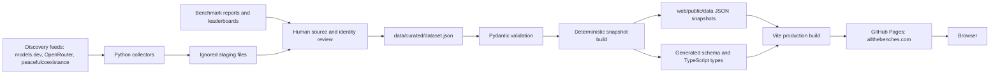
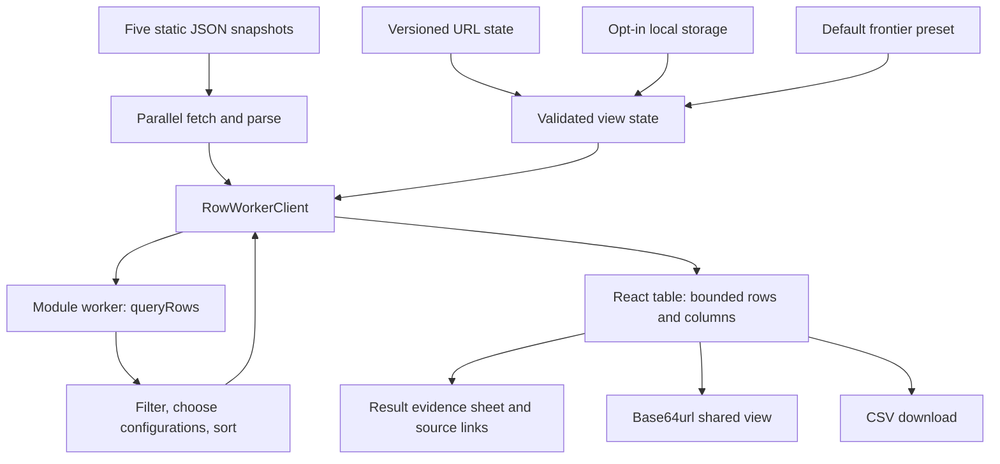
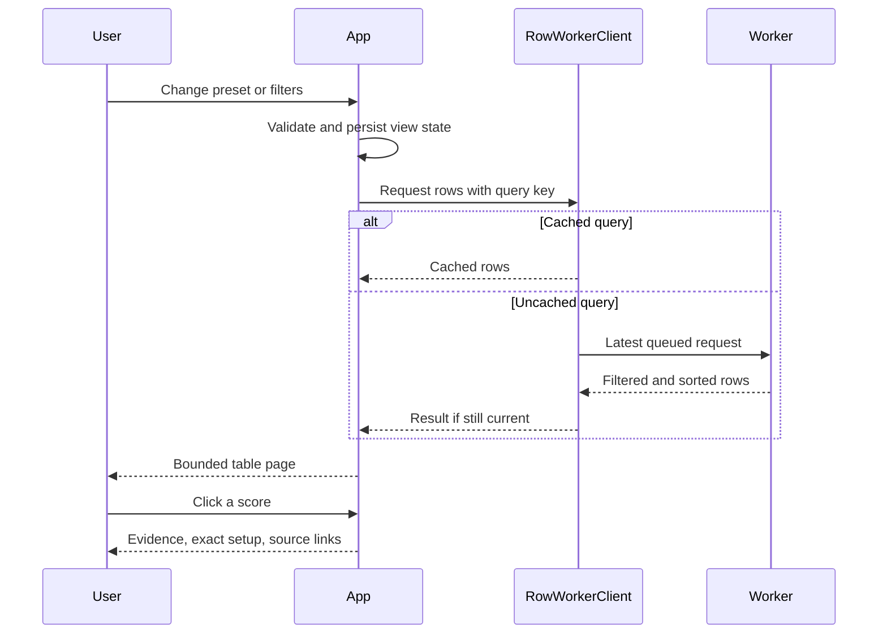
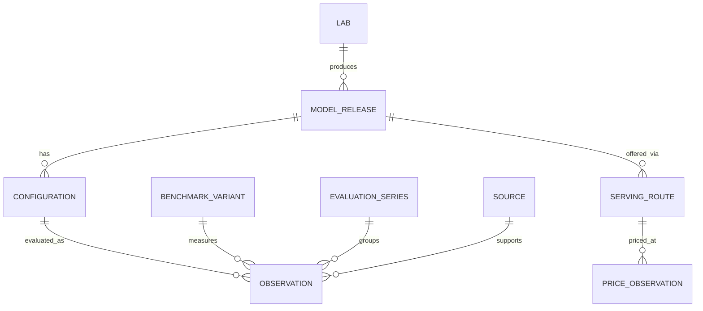

# Architecture

All the Benches is a static application. Python turns reviewed evidence into versioned JSON snapshots; GitHub Pages serves those files and the built React app. Browsing requires neither an application server nor upstream API credentials.

## System and data flow

Collection is discovery, not automatic publication. Reviewers resolve exact releases, configurations, benchmark versions, and sources before changing the canonical dataset. Scheduled collection uploads a review artifact; it does not commit data or deploy scores.

## Browser architecture

URL state takes precedence over saved state and defaults. `#/?v=b1.` stores state in the fragment so large comparisons never reach the static host’s request-line limit. Detail routes carry the same fragment parameter; legacy query-string links remain readable. `b1.` encodes UTF-8 JSON as base64url; legacy JSON links remain readable. Encoding is not encryption. State is size-limited and allowlist-validated. Local storage is opt-in; shared links do not silently replace the saved view.

`loadSnapshots` currently fetches catalog, results, details, market, and manifest together. Evidence panels are opened on demand, but their data is already loaded; this is not lazy data fetching.

The worker receives the immutable snapshot once. Its client allows one active query and one replaceable queued query, rejects stale responses, and caches five result sets. If worker creation or execution fails, queries fall back to a deferred main-thread calculation. That fallback preserves functionality but cannot guarantee responsiveness on larger datasets.

## Interaction sequence

## Data relationships and comparison boundaries

This is a conceptual diagram; `pipeline/schema.py` is the exact contract. A model release is distinct from its reasoning level, harness, precision, and evaluation setup. Benchmark versions, subsets, metrics, and protocols must not be merged merely because their names match. Conflicting reports remain visible. Missing values are not zero. See [Data model](DATA_MODEL.md) for detailed rules.

Heatmaps and bold winners operate per benchmark across eligible filtered configurations, respecting score direction. They are visual aids, not claims that heterogeneous evaluation setups are scientifically interchangeable.

## Performance and layout

Both orientations share score rendering and evidence behavior. Benchmark rows are the default. Rows are paginated in batches of 50, and viewport-based column capacity is capped at 24. Pagination bounds DOM size; this is not an unbounded virtualized grid. Sticky labels and headers are CSS-based. Model detail tooltips mount only while hovered or focused.

The pre-commit and CI gates cover render/update regressions, state parsing, filtering, worker behavior, generated-output drift, type/lint errors, and gzip budgets. They do not replace Firefox profiling or cross-browser accessibility testing. See [Performance](PERFORMANCE.md) and [investigation](PERFORMANCE_INVESTIGATION.md).

## Code map

| Location | Responsibility |
| --- | --- |
| `pipeline/schema.py` | Canonical data contract and validation |
| `pipeline/collectors.py`, `pipeline/reconcile.py` | Discovery and external identity reconciliation |
| `pipeline/build.py` | Deterministic snapshots and generated contracts |
| `web/src/state/` | URL/saved state validation and persistence |
| `web/src/data/` | Loading, selection, worker queue, heatmaps and viewport capacity |
| `web/src/App.tsx` | View orchestration and model-row table |
| `web/src/components/` | Transposed table, evidence, filters and shared UI |
| `scripts/` | Local and CI quality gates |
| `.github/workflows/` | Checks, deployment and metadata staging |

## Delivery and trust

Deployments build from committed reviewed data. No API key belongs in a `VITE_` variable: those values are public build inputs. Upstream text and source URLs are evidence, not executable instructions. Generated snapshots and diagrams are committed artifacts; diagrams render natively on GitHub and require no diagram service.

See [Deployment](DEPLOYMENT.md), [Contributing](../CONTRIBUTING.md), and [Security](../SECURITY.md).

## Dedicated reference pages

`Router.tsx` uses `#/models/<id>` and `#/benchmarks/<id>` routes, which survive
refreshes on GitHub Pages without a server rewrite or 404 fallback. Detail pages
are lazy-loaded. The existing `v` matrix-state parameter is retained when users
follow entity links; Back to comparison matrix removes only the hash. Explicit
“View in the matrix” links create a new focused view: the benchmark across all
models, or the model's configuration with the most published observations.

`EntityPage.tsx` reads the same static snapshots as the matrix. Score cards include
only observations referenced by published display cells, keep conflicting reports
separate, and expose their original source, locator, protocol, and setup. Rendering
is bounded to 25 score cards per page. Unknown IDs and malformed routes show a
recoverable not-found page. No runtime API or new hosting service is required.
