# Automated benchmark collection

The daily `Collect benchmark review proposals` workflow runs Epoch, Vals,
Artificial Analysis, Arena and LiveBench independently. A failure in one source
cannot prevent the others from completing. Run it manually from Actions as well.
The executable registry is `data/collection/sources.json`; source-specific parsing
and metric contracts remain Python code, not arbitrary commands supplied by a feed.

## Review-first lifecycle

```mermaid
flowchart LR
  Registry --> Fetch
  Fetch --> Archive[Content-addressed gzip evidence]
  Archive --> Parse[Existing source importers]
  Parse --> Validate[Schema and reference checks]
  Validate --> Classify[New / unchanged / conflicting entities]
  Classify --> PR[One review PR per source]
  PR --> Approval[Explicit hash approval and conflict resolution]
  Approval --> Build[Offline build and existing CI]
  Build --> Pages
```



Collection never changes the production dataset. Successful runs stage
`data/automation/<source>/candidate.json`, `report.json`, `captures.json`, `REVIEW.md`
and compressed raw evidence. Source bytes are hashed, archived before parsing,
and available for offline replay. Evidence is committed to the proposal branch;
merging the evidence PR preserves it in Git, independently of the 90-day diagnostic
artifact retention. Keep archived evidence when promoting candidates. Do not delete
unmerged proposal branches until useful evidence has been retained.

Each source has one stable `automation/benchmarks-<source>` branch and PR. Unchanged
content preserves capture timestamps; unchanged proposals do not create new commits.
The workflow explicitly dispatches Check on bot branches because PR events created
with GITHUB_TOKEN do not trigger another workflow. The repository setting allowing
Actions to create pull requests must be enabled. Collection failures remain failed
Actions runs with diagnostic artifacts; they do not publish partial candidates.

## Local execution and replay

```sh
uv sync --frozen --group collectors
uv run --frozen --group collectors python -m pipeline.automation \
  --source epoch --output data/automation/epoch
uv run --frozen --group collectors python -m pipeline.automation \
  --source epoch --output data/automation/epoch --offline
```

Replay requires the same parser/contracts and curated dataset. No network is used
in offline mode. Missing or corrupt evidence fails closed. Reports record catalog,
parser and evidence hashes. Download retries are bounded; 429 and transient server
errors retry, permanent client errors fail, and decoded payloads are size-limited.

## Approval and publication

Read coverage scope, unresolved identities, exclusions and entity conflicts in the
report alongside original captures. New IDs are candidates, not automatically
trusted identities. Conflicting IDs are listed with changed fields, never overwritten.
Resolve corrections by retaining source-specific history and explicit supersession,
then regenerate the proposal and report before approval.

For a conflict-free, reviewed candidate:

```sh
uv run python -m pipeline.promote_candidate data/automation/epoch \
  --approve-sha256 THE_REVIEWED_CANDIDATE_SHA256
uv run benches build --offline
```

Promotion checks both the approved hash and the exact catalog used to generate the
proposal. A concurrent catalog change requires regeneration and review. Commit the
curated/generated output through the normal pre-commit checks and PR process. No
scheduled job invokes promotion or enables auto-merge. Existing snapshot presets
are not silently widened; changes to preset scope remain a review decision.

## Source boundaries

- Epoch: current official ZIP, reviewed mappings, existing primary-metric contracts.
- Vals: current reviewed pages, exact reviewed label/profile identities and table
  headers. Unknown identities are queued; changed headers fail. Source-reported
  latency remains raw row evidence; no new latency unit inference is introduced.
- AA: current public page serialization, existing reviewed metric fields. Layout
  drift fails closed; undocumented fields do not become scores automatically.
- Arena: resolve the current official dataset revision once, fetch immutable files,
  verify available LFS hashes and retain partition-level audit information.
- LiveBench: reviewed release keys and metric contracts; frontend changes flag a
  release discovery task. New release semantics are not inferred from filenames.

This is a shared collection/review foundation, not unrestricted automatic source
onboarding. Existing adapter audits differ in granularity (source rows versus metric
cells); reports preserve those denominators instead of presenting a misleading
universal coverage percentage. Freshly fetched evidence is not necessarily a newly
published evaluation. Historical scores do not expire merely because they are old.

Pricing/usage/latency continue through the separate metadata collection workflow.
Latency is source-reported only, with the existing units and sampling provenance;
this pipeline does not run paid probes or claim live latency. Daily refresh is not
sufficient for a 30-minute latency freshness promise. Stale measurements must remain
labeled, and a higher-frequency service is a separate operational decision.

## Checks

Pre-commit and CI already run all Python tests and Ruff, including the new archive,
corruption, identity, correction, review-gate and adapter tests. Collection CI also
replays each successful run offline and compares candidate/report bytes. Existing
build, data-size, browser layout and dependency checks remain in the publication path.
Network collection is deliberately excluded from pre-commit.
