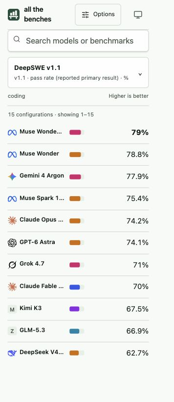
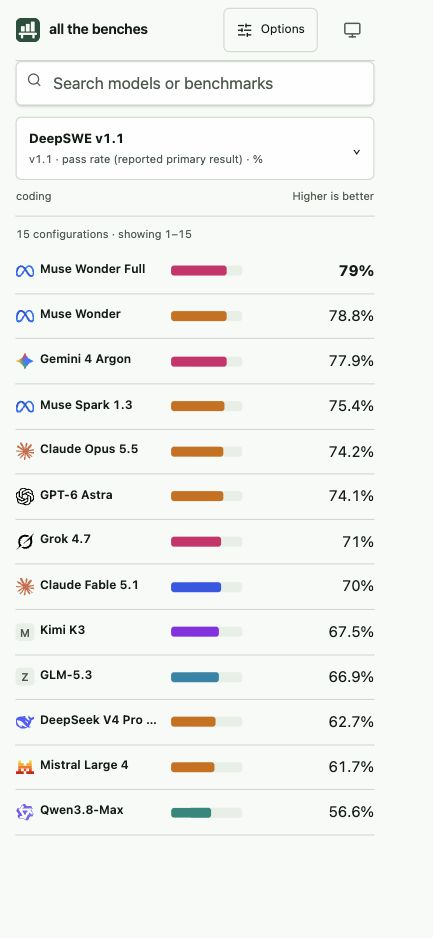
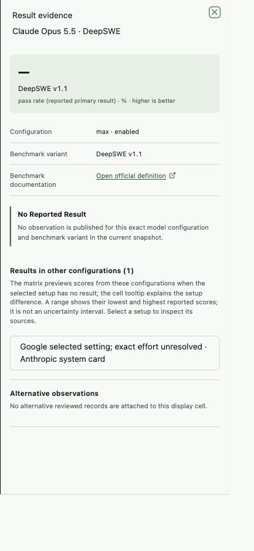
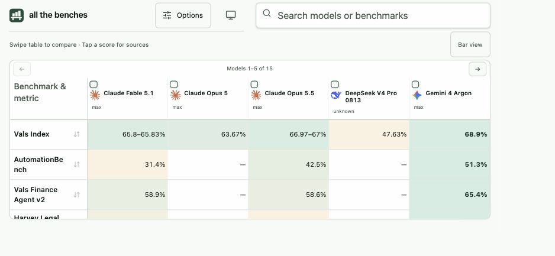

# Deep code, data, architecture, and UI review

Reviewed 22 October 2026 against commit `c04f170050d4ee81dd0d0f04e29257be33f26668`. The working tree was clean at the start. This review adds documentation and diagnostic evidence; it does not change application behavior or curated data.

The static architecture is a good fit for this product. The strongest parts are the explicit release/configuration split, preserved source evidence, review-only collection, deterministic publication, bounded table rendering, and substantial regression coverage. The main weakness is that the application does not have one authoritative definition of the score a user is comparing. Python publication, client merging, filters, desktop sorting, mobile ranking, coloring, evidence, and CSV each make some of that decision independently.

That weakness already produces incorrect behavior. Changing selected benchmarks can leave a stale configuration in the table. Scores from other configurations look like scores for the selected configuration. Mobile ranks those previews while desktop does not. Old price quotes still satisfy price constraints. Address these before investing in more benchmark coverage or additional visual polish.

Implementation tickets and acceptance criteria are in [Recommended fixes](RECOMMENDED_FIXES_2026-10-22.md).

## Implementation follow-up — 23 October 2026

The review below records the original behavior at the reviewed commit. The working-tree follow-up fixes R01 (configuration cache invalidation), the exact-setup display/ranking portion of R02, and R03 (current-price eligibility). See [implementation and verification notes](REVIEW_FIXES_2026-10-23.md) for the changed policy, regression coverage, and remaining work. Original diagnostics are retained as historical evidence; their assertions intentionally demonstrate the old defects and should not be used as passing regression tests.

## Scope and verification

Reviewed the canonical schema, publication and saturation logic, collectors, promotion path, source import patterns, snapshot loading, worker queue, selectors, view persistence, routing, CSV generation, React components, responsive CSS, generated reference pages, CI/deployment workflows, existing tests, and earlier architecture/UI reviews.

Executed verification:

| Check | Result |
| --- | --- |
| Python tests | 95 passed |
| Frontend unit/component tests | 101 passed across 16 files |
| Chromium layout/integration tests | 64 passed |
| Frontend ESLint; Python Ruff | Passed |
| TypeScript and Vite production build | Passed; Vite warned about the 511.41 kB main JS chunk |
| Canonical dataset validation | Passed |
| Generated schema, snapshots, and static-page drift check | Passed |
| Repository bundle budgets | Passed |
| Additional diagnostic probes | Four frontend probes and Python mutations reproduced the issues described below |

Browser inspection used the local production build. Direct visual checks included 320×740 and 390×844 portrait, 844×390 landscape, and 1440×900 desktop CSS viewports. The existing suite additionally exercises intermediate phone/tablet sizes, both matrix orientations, theme contrast, navigation, selection, reload, and lazy evidence. The browser's viewport override was adjusted for its existing zoom and verified with `innerWidth`/`innerHeight`.

This is not an independent verification of every upstream benchmark number, a live dependency vulnerability audit, a physical-device test, or a full assistive-technology audit. Safari/iOS keyboard/notch behavior and Firefox were not tested. Passing geometry tests does not establish scientific comparison correctness or screen-reader usability.

### Snapshot facts

| Entity / measure | Count |
| --- | ---: |
| Labs / model releases / configurations | 11 / 47 / 344 |
| Benchmark variants / evaluation series | 593 / 2,172 |
| Observations | 6,546, all currently marked `reviewed` |
| Published series-specific cells | 6,516 |
| Distinct configuration–benchmark pairs | 6,480 |
| Series declared comparable / heterogeneous / unknown | 357 / 23 / 1,792 |
| Sources / external mappings | 256 / 386 |
| Serving routes / price quotes / performance records | 86 / 86 / 460 |
| Usage records | 0 |
| Observations with uncertainty | 2,920 |
| Observations with supersession links | 0 |

At the fixed review instant `2026-10-22T14:30:00Z`, all 86 prices exceeded the 48-hour policy and all 460 performance records exceeded the 30-minute policy. Historical benchmark age is a different issue and should not invalidate historical scores.

Raw measurements and reproducible diagnostics: [pipeline results](review-assets/2026-10-22/pipeline-probes.json), [pipeline probe script](review-assets/2026-10-22/pipeline_probes.py), [frontend output](review-assets/2026-10-22/frontend-probes.txt), [frontend probe source](review-assets/2026-10-22/frontend-probes.test.tsx.txt).

## Prioritized code findings

P1 means a current correctness/trust issue to address first. P2 means a material functional, publication, or usability issue. Latent issues below were reproduced using synthetic in-memory modifications; they are not claims that the committed data already contains those records.

### R01 — P1: Changing benchmark columns does not invalidate configuration selection

**Location:** [useViewRows.ts](../web/src/data/useViewRows.ts), lines 13–20; [selectors.ts](../web/src/data/selectors.ts), lines 304–317.

`rowQueryKey` includes `visibleColumnIds` only when search is nonempty. However, `rowsForView` uses selected benchmarks to choose the configuration with the best coverage in an all-model preset even when search is empty. A column change therefore leaves the hook's key unchanged and never recomputes the rows. The worker cache uses that same incomplete key.

**Reproduction:** Start with `all_models_oct2026` and its full benchmark list, then select only `terminal_bench_4`. The hook retains `gpt6_astra_max`; a fresh call to `rowsForView` returns `gpt6_astra_high`. The same probe finds stale selections for GPT-6.1 Sol and GPT-5.6 Sol. Reloading can change the selected configuration for the same visible URL state.

**Fix:** Include the effective benchmark selection in the query dependency contract. Test an actual hook update, not just independent selector calls. Also test the same transition through a real worker.

### R02 — P1: Alternate configurations are presented and ranked as ordinary scores

**Location:** [App.tsx](../web/src/App.tsx), lines 299–314; [selectors.ts](../web/src/data/selectors.ts), lines 344–366 and 384–407; [PortraitComparison.tsx](../web/src/components/PortraitComparison.tsx), lines 48–59 and 100–114; [heatmap.ts](../web/src/data/heatmap.ts), lines 23–36.

When the exact configuration has no cell, `ScoreButton` displays numeric scores from other configurations. The distinction is mostly in a tooltip and accessible name. Both exact and alternate values receive heatmap colors. Mobile additionally sorts by alternate-setup or multi-report ranges, including cells merged into `disputed`; desktop sorting uses the exact cell and puts disputed/missing values last. Mobile sorts ranges by their low endpoint for both metric directions, a presentational rule rather than an evaluation policy.

**Observed:** The default mobile DeepSWE view puts Claude Opus 5.5 at **74.2%** with a normal bar. Tapping it opens **“No reported result”** for `max · enabled`, followed by a different, unresolved-effort configuration. On desktop, FrontierSWE shows a bold **55%** next to visible **62.3%** and **56.3%** previews. The exact-only winner rule explains this internally, but the visible legend simply says “Bold = best.”

There is a further concrete inconsistency: `previewScore` returns other-configuration values before checking `saturationStates`, whereas `ScoreButton` disables those alternatives when a saturation filter is active. The probe returns a DeepSWE preview of 74.1 for a missing GPT-6 Astra configuration under `['not_saturated']`. This can produce a bar/ranking for a score button showing a dash when that benchmark remains visible.

**Fix:** Introduce one resolved-cell representation with provenance and ranking eligibility. Preserve exact-configuration semantics by default; visibly label alternate setups and offer a separate reported-results mode if desired. Do not let viewport width choose comparison policy. Share the resolution with filtering, export, colors, and evidence.

This is a deliberate current product behavior, as documented by the earlier mobile review, rather than an accidental CSS regression. The recommendation is to revise that behavior because it contradicts the product's exact-configuration positioning.

### R03 — P1: Price filters accept stale quotes and do not enforce monetary units

**Location:** [selectors.ts](../web/src/data/selectors.ts), lines 259–265; [App.tsx](../web/src/App.tsx), lines 37–38 and 172; [EntityPage.tsx](../web/src/components/EntityPage.tsx), lines 78–89; [freshness.py](../pipeline/freshness.py).

Filtering checks numeric amounts and `price.available`, but not quote age, route availability, currency, or `price_unit`. `Number()` also discards the exact decimal representation retained by the schema. The UI's threshold is labeled dollars per million tokens. The matrix ranges combine the supplied numbers and label them using the first quote's currency/unit.

**Current impact:** A permissive input-price filter still returns nine model rows even though every published quote is stale under the documented policy. The matrix does not mark the quoted ranges stale. Model detail pages do identify stale performance; that does not establish price eligibility.

**Synthetic proof:** A quote dated 2000, denominated in EUR per token at `0.5`, on a route marked unavailable, passes the `$1/M` filter when its own `available` flag remains true. The current real dataset is uniformly USD per 1M tokens, so the unit/currency bug is latent; staleness is current.

**Fix:** Resolve an eligible quote for one route and context tier using an explicit as-of time, supported currency/unit, route availability, and exact normalized amount. Display the qualifying quote and its date. Exclude stale quotes by default, with an explicit historical option. Do not convert currencies without a documented conversion source and policy.

### R04 — P2: `supersedes` is stored but ignored during publication

**Location:** [build.py](../pipeline/build.py), lines 78–99; [schema.py](../pipeline/schema.py), line 338.

`select_observations` groups all reviewed records and decides agreement only from `(value, unit)`. It never follows `supersedes`. The schema checks only that referenced IDs exist, allowing self-reference, cycles, and unrelated corrections.

**Synthetic proof:** Add a reviewed correction to the first observation, lower its score by 0.1, and set `supersedes` to the original ID. Validation passes, but publication emits a disputed cell containing both records rather than the correction. There are no supersession links in the current snapshot, so this is a lifecycle defect awaiting the first use of that field.

**Fix:** Validate and resolve a correction graph before grouping active evidence. Preserve predecessors in historical evidence and define which changes require a new configuration/variant instead of a correction.

### R05 — P2: Explicitly disputed observations disappear from normal evidence views

**Location:** [build.py](../pipeline/build.py), lines 81–84; [App.tsx](../web/src/App.tsx), `EvidencePanel` around lines 360–366; [EntityPage.tsx](../web/src/components/EntityPage.tsx), lines 49–52; [static_pages.py](../pipeline/static_pages.py), lines 124–126.

The publisher only creates cells from records whose review state is `reviewed`. Evidence views then enumerate observations referenced by those published cells. Changing an observation to the schema's explicit `disputed` state removes it from the matrix and ordinary entity/evidence views, even though it remains in downloadable details. This differs from a cell inferred to be disputed from conflicting reviewed records, which does remain visible.

**Synthetic proof:** Mark the first observation `disputed`; its ID is no longer in any published cell. The current dataset contains only reviewed observations, so the risk arises when curation starts using these statuses.

**Fix:** Separate publication eligibility, numeric ranking eligibility, and lifecycle status. A disputed observation should be inspectable with a warning and without a ranking value; retracted/superseded records should have explicit historical access.

### R06 — P2: The frontend discards the publisher's evaluation-series dimension

**Location:** [selectors.ts](../web/src/data/selectors.ts), lines 93–108; [build.py](../pipeline/build.py), lines 78–99; [coverage.ts](../web/src/data/coverage.ts), lines 8–16.

Python emits one cell per configuration, benchmark, and series. The frontend indexes only by configuration and benchmark, converts multiple series into a disputed aggregate, and retains the first cell's other metadata. Separate protocols are not necessarily contradictory reports. This also makes coverage calculations and the matrix disagree: coverage uses original cells, while the matrix uses the collapsed cells.

**Current scope:** 36 configuration–benchmark pairs contain multiple series, and every one of those pairs has individually undisputed series-specific cells. All are nevertheless collapsed into the frontend's disputed state. The UI then often renders their min–max range.

**Fix:** Preserve a list of series-specific groups. Select one through an explicit policy or show “multiple protocols” as a separate state. Reserve “disputed” for a conflict that remains within the selected compatible group. Generate coverage and export from the same policy result.

### R07 — P2: Validation is stronger on references than on evidence meaning

**Location:** [schema.py](../pipeline/schema.py), particularly `Observation`, `MetadataClaim`, `ExternalMapping`, and `Dataset.references_and_uniqueness`; [selectors.ts](../web/src/data/selectors.ts), lines 163–176.

The schema correctly rejects duplicate IDs, broken foreign keys, score-unit mismatches, out-of-range scores, and non-finite observation values. It still accepts reviewed observations with empty locator/evaluator/setup, mismatched model and route mappings, and self-supersession. Source URLs are arbitrary strings. Parameter claims are `Any`; ranges, numeric finiteness, field-specific units, and selected-claim conflicts lack a canonical validator.

`completeSetup` is also weaker than its label: it requires only four of nine named fields, accepts empty strings as known, recognizes only a few exact unknown markers, and checks all setup metadata rather than a typed evaluation contract. The compact runtime snapshot converts most setup values to `true`, making frontend policy increasingly dependent on the exact summary transformation.

**Fix:** Add a publication validator distinct from permissive staging validation. Use typed setup/uncertainty/parameter-value structures with explicit unknown states. Generate normalized completeness flags in Python. Keep free-form source extras for fidelity, but do not use their arbitrary keys as the decision contract. Unknown must remain an allowed, explicit fact rather than a reason to invent evidence.

### R08 — P2: “Independent evaluations only” excludes whole configurations because of unrelated results

**Location:** [selectors.ts](../web/src/data/selectors.ts), lines 249–253; [App.tsx](../web/src/App.tsx), line 333.

Evidence filters inspect every reviewed observation for the configuration, not the selected benchmark's eligible reports. A self-report on an unrelated benchmark excludes an independently measured selected result. This makes the view change when unrelated evidence is added.

**Current example:** `claude_opus55_xhigh` has evaluator-measured ARC-AGI-1/2 results and a self-reported Terminal-Bench 4 result. Selecting only ARC and enabling independent-only still rejects that configuration.

The “Has comparable evidence” filter is explicitly documented as a row-level existence test; that label is accurate and should not be treated as a strict-comparison guarantee. The independent-only and incomplete-setup labels, however, read as result policies.

**Fix:** Filter observations/cells first, then derive whether the configuration has visible results. If a whole-configuration purity filter is useful, name it explicitly and keep it separate.

### R09 — P2: New deployments remove lazy evidence needed by already-open sessions

**Location:** [runtime_snapshot.py](../pipeline/runtime_snapshot.py), lines 20–24; [snapshots.ts](../web/src/data/snapshots.ts), lines 15–40; [App.tsx](../web/src/App.tsx), `LazyEvidence`.

Content-addressed evidence prevents mixing versions, which is good. However, the build deletes every previous evidence file. An open tab keeps its old comparison snapshot and evidence URL. If publication changes the evidence before the user first opens a drawer, the old URL can return 404. Retrying the drawer requests the same now-removed URL.

**Fix:** Retain evidence for a defined release window, or add an explicit snapshot-changed recovery that reloads the comparison and reopens the selection against the new snapshot. Never silently attach new evidence to old scores. Test deployment A → deployment B with an A session still open.

### R10 — P2: A successful empty feed replaces the last good discovery snapshot

**Location:** [collectors.py](../pipeline/collectors.py), lines 35–58 and 102–108.

The collector preserves old data on HTTP/JSON errors but treats any valid JSON response as healthy. A `200` with an empty list or unexpected-but-valid shape can replace a good feed and empty its mapping queue. The benchmark automation path has a no-candidate guard; the metadata collector does not.

**Synthetic proof:** A mocked OpenRouter response containing one model is followed by `200 {"data": []}`. The saved envelope is `status: ok` with two empty feed lists. This is staging data, so it does not directly erase curated scores, but it removes the intended recovery/discovery protection.

**Fix:** Validate each source envelope and meaningful completeness before replacing its last-good payload. Record a new attempt separately. Explicitly distinguish a reviewed legitimate empty response from an upstream error page/schema change or unexpected collapse.

### R11 — P2: Published uncertainty is not exposed in the evidence UI

**Location:** [App.tsx](../web/src/App.tsx), `EvidencePanel`; [EntityPage.tsx](../web/src/components/EntityPage.tsx), lines 69–73; [schema.py](../pipeline/schema.py), line 126.

2,920 observations contain uncertainty, but neither the score drawer nor the entity score details explicitly render `record.uncertainty`. Some sources repeat interval information in setup extras; that is not a consistent uncertainty presentation. Users can inspect a score's source yet miss its published interval or standard error. The min–max ranges shown in the matrix describe different reports/setups and are a different concept.

**Fix:** Render typed uncertainty with its method, level, unit, and sample count when available. Keep cross-report ranges labeled separately. Numeric-best highlighting must continue to avoid implying statistical significance.

### R12 — P2: Configuration labels do not uniquely identify choices

**Location:** [ModelPicker.tsx](../web/src/components/ModelPicker.tsx), line 20; [selectors.ts](../web/src/data/selectors.ts), `shortReasoning`; [PortraitComparison.tsx](../web/src/components/PortraitComparison.tsx), lines 64–68 and 110–114.

The picker renders only `reasoning_label ?? mode`; compact rows further reduce descriptive labels to the mode. Adding “Reasoning:” for repeated model names therefore does not reliably distinguish configurations.

**Current example:** Claude Opus 5.5 has three separate configurations labeled `max`, three `xhigh`, and several unrelated configurations reduced to `unknown`. Across the dataset, 34 releases have collisions under the compact label. The model detail matrix can include all of these at once.

**Fix:** Use a readable unique label combining setting, evaluator/provider context, and a short setup discriminator. Show the stable ID in details. Do not merge similarly named configurations without evidence of identity; some duplication reflects unresolved mapping, not redundant data.

### R13 — P2: Removing a preset broadens a saved/shared view to the default

**Location:** [viewState.ts](../web/src/state/viewState.ts), line 75; [stateRuntime.ts](../web/src/state/stateRuntime.ts), lines 30–40.

Unknown benchmark/configuration IDs can be retained as unresolved, but an unknown preset makes parsing fail. Loading then replaces the entire view with the default. If a dated preset is retired, a narrowly filtered shared comparison can become a broad frontier comparison with its restrictions discarded. This contradicts the documented preservation of unresolved restrictive state.

**Fix:** Preserve the view with an unresolved preset and no matching rows until the user chooses a replacement. Maintain explicit migrations/aliases where identity is known. Malformed syntax can still use the invalid-link recovery path.

## Data-model critique

### Keep the long-form evidence model

Release → configuration → observation, with benchmark variants, evaluation series, sources, routes, and market observations, is the correct foundation. A wide table should remain a derived view. Do not collapse historical observations into one editable score per model. Retain the good treatment of zero, missingness, decimal quote strings, and explicit source relationships.

### Separate identity, protocol, provenance, and display policy

The current 344 configurations and 2,172 series for 47 releases reveal how much source-specific context is encoded into identities. Some separation is scientifically necessary. However, settings such as `reasoning_label` also contain prose about unresolved effort and source-selected settings, while series IDs can be model-specific. Only 16 series have a non-null setup fingerprint. These structures are hard to query consistently and create pressure to merge them loosely in the UI.

A better contract has four explicit layers:

1. **Configuration identity:** known model/runtime settings, plus explicit unknown states.
2. **Evaluation protocol:** benchmark variant, harness/scorer, tools, sampling, judge, budget, and versioned compatibility policy.
3. **Observation/provenance:** value, precision, uncertainty, evaluator, source capture, original/quoted relationships, review/lifecycle history.
4. **Comparison selection:** exact chosen series/reports, selection reason, eligibility flags, missing reason, and alternatives.

Presets currently contain IDs and editorial metadata, but no implemented per-column source/series policy. The data-model document describes such a policy; code should either implement it or narrow the published promise. Avoid inferring compatibility from equal numeric values or matching display names.

### Make lifecycle and audit fields operational

Review status is a mutable string without reviewer, review timestamp, rationale, or event history on the observation. Git provides coarse auditability, but consumers cannot distinguish review acts from source publication or capture dates. Add explicit review/correction events when the process expands. Original-observation links are also needed for quotes/reposts: `reporting_relationship` labels the relationship, but does not model its target.

Missingness is modeled explicitly, but only three missing-cell records exist. Most blanks are generated absence. Label them as “no published result for this setup,” not a claim that evaluation never occurred. Permit a missing current value alongside retained historical/retracted evidence; the existing missing-cell validator rejects any observation on that pair regardless of lifecycle.

### Normalize measurement semantics without erasing source fidelity

Units currently include `%`, `percent`, `fraction`, `rate (0–1)`, several point-scale strings, and source-defined scores. Keep raw unit/value and a separately documented normalized value where justified. UI scale decisions should use structured bounds/unit metadata, not string equality such as `unit === '%'`. Prices need currency, unit, quote scope, tier, age, and route status as part of eligibility. Usage needs an explicit platform-variant mapping rather than matching unrelated nullable string keys.

## Architecture and maintainability

### Preserve static delivery; consolidate domain decisions

No runtime backend or database is necessary for the current size. Static publication provides low operational cost, reproducibility, and a small credential exposure surface. The right next step is clearer domain boundaries within the existing Python/TypeScript system.

The publisher should emit authoritative observation/cell classifications. A shared TypeScript resolver should turn those records and the selected policy into a single comparison model. Desktop, mobile, evidence, coverage, and CSV should render that result. Today `ScoreButton`, `previewScore`, `scoreRanges`, `displayedScoreRanges`, `queryRows`, `coverageIndex`, and `downloadCsv` encode overlapping rules. R02, R06, and R08 are consequences of that split.

### Split `App.tsx` by responsibility

The 402-line count understates its size: many complete components and entire JSX trees occupy single very long lines. It owns data loading, persistence, navigation handling, worker queries, responsive modes, two table paths, filter and column panels, evidence, market formatting, and export. This makes semantic changes difficult to review and gives functions broad access to unrelated state.

Extract comparison state/controller, filter draft, cell rendering, evidence details, market presentation, and export into focused modules. Format the JSX normally. A formatter and smaller pure functions will help more than introducing another state-management framework. Consolidate CSS around named surfaces and a small breakpoint vocabulary; the current file layers several generations of 600/768/800/1000/1100px rules and later overrides.

### Finish the runtime read model

The initial comparison payload is **9,064,473 decoded bytes** / **453,413 gzip bytes**. Lazy evidence is another **9,137,508 decoded bytes** / **593,834 gzip bytes**. Gzip makes transfer reasonable; decoded parsing, object construction, indexes, and worker structured cloning still cost CPU/memory on phones. The worker avoids repeated query work on the main thread, but does not eliminate startup parsing or main-thread color/default-benchmark scans.

Keep archived exports complete, but generate only fields needed to choose and display the initial view: explicit policy flags, compact series references, indexed cell summaries, and small source labels. Avoid copying thousands of free-form setup keys merely to replace their values with booleans. Catalog pages currently call `loadFullSnapshots`, even when only listing models/benchmarks; coverage should be available without downloading all evidence.

The current startup budget passes. No unsupported claim of a measured mobile performance failure is made here. Next measurements should include decoded bytes, parse time, worker initialization, long tasks, and memory on slower hardware, not only gzip and JSDOM render duration.

### Publication and operations

Generated-output checks are a strong feature. Improve them to compare both directions: `check-generated.py` checks expected files but does not detect unexpected stale generated pages left in the repository. Keep archival manifests and hashed evidence mutually consistent, and define retention before relying on lazy old-snapshot access.

The discovery and benchmark collection paths have different failure semantics; unify their last-good/attempt/health contract. The freshness workflow reports age but does not itself refresh the reviewed market data, so the UI must remain useful and honest while quotes are old. Review history/source dates and current market freshness should remain separate.

CI and deployment repeat much of the same check sequence. A reusable verification workflow would reduce drift. The main bundle warning and narrow CSS gzip headroom deserve monitoring, but passing budgets should not be arbitrarily tightened without device measurements.

## Desktop UI critique

The restrained palette, compact matrix, sticky labels, searchable catalogs, separate benchmark-link/sort actions, and direct evidence access work well. At 1440×900, the toolbar fits and the matrix gives useful density without page-level horizontal overflow. Paginated columns are reasonable for the current data volume.

The scientific meaning is less legible than the visual hierarchy. Configuration labels are tiny; protocol identity is usually hidden; alternate results look like normal cells; the visible winner rule can disagree with the visible largest number. Make status visible where the user reads a value. A small “other setup” or “multiple protocols” label is more valuable than preserving one more pixel of density.

The global search combines model, lab, and benchmark search. A benchmark match switches filtering behavior, which is efficient for experienced users but difficult to predict. Show whether the query matched models or benchmarks, and provide explicit category/source discovery in the benchmark picker. Avoid implying that “All models” means every model in the field: it currently means all 47 curated releases.

Source-dated presets are useful, but “Frontier” is hard-coded to `frontier_oct2026` in several paths. Move current/default designation to curated metadata. Preserve historical preset links.

## Mobile UI critique

### What works

The single-benchmark bar view is a sensible phone default. Search, Options, benchmark selection, and score access are easy to find. At the inspected sizes there was no document-level horizontal overflow. The 844×390 bar view uses landscape space effectively. Model detail pages reflow cleanly, retain source access, and offer a focused matrix link. Existing tests cover rotations and substantial mobile interaction paths.

### U01 — P2: At 320px, fixed score width consumes the comparison

**Location:** [app.css](../web/src/app.css), lines 510–516 and 544–545.

At 320 CSS pixels, the score button reserves 120px and the observed bar track is only **30.17px** wide. Several model names are truncated to forms such as “Claude Opus …” and “Muse Wonde…”. Since source/configuration distinctions are already hidden, further losing the release name makes comparisons difficult. A hover title is not a dependable touch interaction.

**Recommendation:** Use a two-line card at narrow widths: full model plus setup/status above a full-width bar and compact value. Allocate value width by content, and use an explicit range treatment. Keep the 44px hit area while allowing the label to wrap. Small score differences on a 30px bar are effectively unreadable.

### U02 — P2: Essential evidence distinctions are absent from the card

The 390px view looks like a ranked list of exact results, but R02's alternate-configuration qualification is only revealed after tapping. Reasoning/setup is shown only when multiple configurations of the same model are present. Configuration information should always be available visibly, and repeated labels must be unique as in R12. Randomly hashed bar colors repeat across different models; the hint “colors identify models” overstates their identifying power.

### U03 — P2: Picker keyboard semantics and dismiss targets need work

**Location:** [PortraitComparison.tsx](../web/src/components/PortraitComparison.tsx), lines 119–129; [sheet.tsx](../web/src/components/ui/sheet.tsx), `DialogPrimitive.Close`; [TransposedTable.tsx](../web/src/components/TransposedTable.tsx), lines 33–36.

The benchmark picker declares a `listbox` with `option` buttons but implements neither arrow-key navigation nor roving focus. Direct verification: Tab from search focuses Vals Index; ArrowDown leaves focus there. Each option remains an ordinary Tab stop, potentially hundreds in an all-model view. Either use a complete listbox/combobox interaction or render a plainly labeled list of buttons.

The sheet Close control measures approximately **16×16 CSS pixels**, much smaller than the otherwise good 44px mobile controls. Enlarge its hit box without enlarging the icon. The default transposed table also uses ordinary data cells for benchmark row labels and lacks the full-table index/sort metadata present in model-row orientation. Add row-header semantics and announce the active sort/pagination context. These are code/keyboard observations, not a claim of full screen-reader conformance testing.

### U04 — P2: Filter discovery is overloaded and configuration names repeat

The filter sheet mounted **741 checkboxes** in the inspected snapshot. At 390px viewport width, the outer drawer has a 1,578px internal scroll height, with additional nested scrolling for long facets; it is not one enormous flat page. Nevertheless, finding one of 593 benchmark variants or one of 86 routes in a small nested list is cumbersome. Several routes share the same visible provider/model label despite distinct variants.

Use searchable facets with counts, selected chips, and category/source grouping. Reuse the searchable benchmark picker for “require a result” and threshold selection. Show matching-result counts before Apply. Do not offer unavailable usage/metadata features without a clear coverage explanation. The text “current snapshot has no selected size claims” is already wrong: it contains 15 selected parameter claims.

### U05 — P3: Options hierarchy and landscape matrix need refinement

Choose models appears after Share and Export CSV, separated from Choose benchmarks. Group model and benchmark selection together, then filters, then sharing/export, then display preferences. Show active category/evidence constraints on the comparison surface, not only inside Options.

At 844×390, the optional matrix is 270px tall and exposes only about three complete benchmark rows beneath headers. Keep the bar view as default, but allow a focused pairwise matrix and less header chrome. Advanced display choice is local component state, so a shared mobile “Matrix view” restores to bars; decide whether sharing is intended to preserve the surface, and serialize it if so.

### U06 — P3: Safe-area padding uses the left inset for both sides

**Location:** [app.css](../web/src/app.css), line 489.

The horizontal shorthand uses `env(safe-area-inset-left)` for both edges. Use independent left/right insets. This is confirmed in source; actual notched-device occlusion was not tested. It remains open from the earlier mobile review.

## Security and resilience observations

Static hosting, no browser credentials, escaped React text, HTTP(S)-filtered links in generated static pages, constrained benchmark-download hosts, download-size limits in the archive collector, hash checks, and explicit candidate promotion are good protections.

Hardening worth scheduling: validate HTTP(S) source/documentation URLs at publication; bound metadata collector response sizes; neutralize spreadsheet-formula prefixes in CSV text fields (quoting alone does not do this); validate the snapshot envelope/schema version at load; and pin workflow actions more tightly if supply-chain requirements demand it. These are attack-surface improvements, not evidence of an exploited vulnerability or malicious current dataset.

The most immediate resilience problem is R09's deleted lazy evidence. Add a worker readiness/query timeout as a further safeguard: the existing fallback handles thrown errors, but a worker that neither answers nor raises an error can leave the comparison busy indefinitely.

## Test strategy critique

The 260 passing tests are meaningful, especially layout bounds, source import identity, zero handling, worker scheduling, and source replay. They do not contradict these findings: several tests assert the present preview behavior, so they can preserve the behavior that needs redesign.

Prioritize invariant tests across surfaces: same query → same selected configuration; same resolved cell → same numeric/ranking eligibility on desktop/mobile/export; unrelated reports cannot hide independently eligible selected evidence; a correction replaces active evidence while preserving history; an A session still opens evidence after B deploys; empty successful feeds do not erase last-good data.

Separate synthetic unit fixtures from tests intentionally using committed production snapshots. Several component tests import large public JSON files, which increases test startup costs and couples unrelated UI behavior to curation changes. Keep a small real-snapshot integration set and small explicit fixtures for edge cases. Add WebKit/Firefox smoke coverage and a focused keyboard/assistive-technology pass before claiming broad mobile accessibility.

## Documentation drift and review limits

`ARCHITECTURE.md` still describes five parallel startup JSON fetches and eager evidence loading. Current code loads `comparison.json` then lazy content-addressed evidence. It also describes a 600px portrait cutoff and a landscape default matrix, whereas the current app uses the bar surface through 1100px in either orientation. Its model-detail matrix description has also changed: current links include all published configurations/benchmarks. Update these descriptions after the behavior decisions, so the documentation is a reliable contract.

No production-code fixes were applied as part of this review. The recommendations intentionally preserve the static deployment and existing evidence rather than proposing a wholesale rewrite. Start with R01–R03, establish one comparison-policy result, then tighten publication lifecycle and mobile information design.
